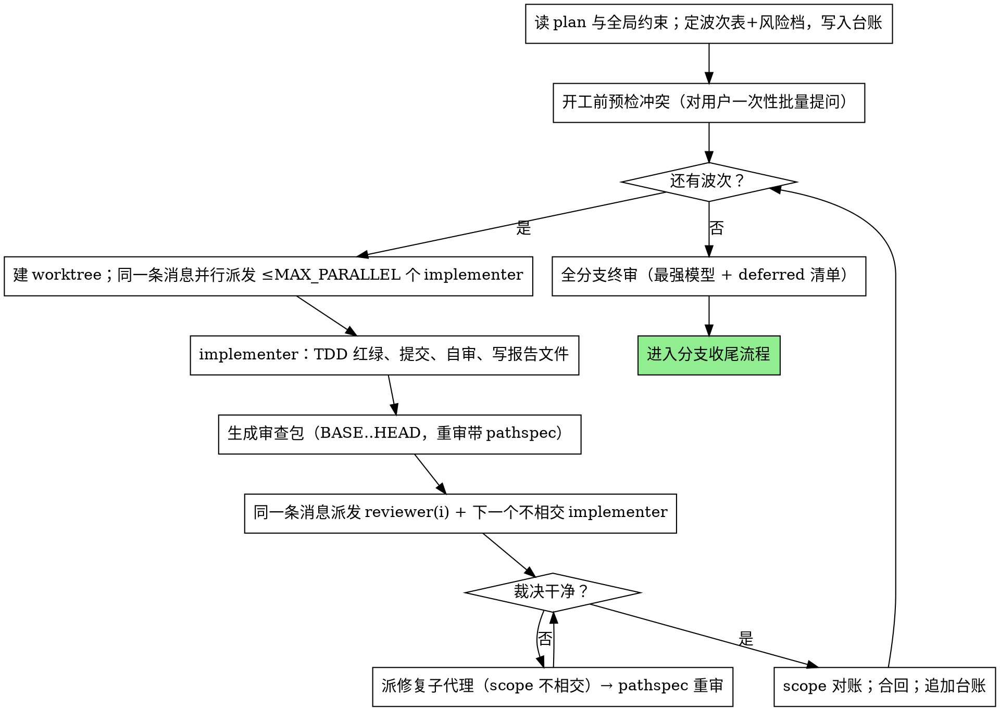

# Shadow Dev TDD — 实现计划执行调度

逐 task 派发全新 implementer 子代理执行 TDD 红绿循环，按风险分级审查，收尾做全分支终审；调度上按文件 scope 分波并行、审查与下一实现重叠，让墙钟时间贴近关键路径而不是任务数之和。

**定位：** 执行对象是**实现计划**——含 `Task N` 清单的 plan 文件（如 `writing-plans` 产物）。与 `shadow-dev-apply` 并列不互替：apply 执行 shadow change brief（Knowledge 驱动、`shadow-dev` CLI 受管）；本技能执行独立 plan，以 git worktree 与台账受管。brief 场景走 apply，不要用本技能顶替。

**执行纪律：** 一切结论引用真实命令与真实输出。子代理在各自任务 worktree 内的 git 提交是本技能的调度机制，不属于脚本旁路；PR 与远端写操作在收尾阶段交回对应流程（`finishing-a-development-branch` 或 `shadow-dev-release`）。TDD 纪律遵循 `norms/verification.md` 分级制：断言优先（先写失败断言、看到红再写实现）是计划可选取证策略；提交前全量套件绿是本流程的**任务级机器门槛**，不上升为全仓规范。

**进场：** 任何操作前，先输出：`▶ [进场] shadow-dev-tdd · 实现计划执行调度`

## 流程



派发任何 implementer 之前，先记录该 task 的 BASE 提交——此后所有审查包都依赖它。

## 调度模型：波次 · 重叠 · 分级

串行链（实现 → 审查 → 修复 → 下一个）是兜底，不是默认。三个机制压缩墙钟时间：

### 1. 波次 —— 独立 task 并行

读 plan 时（派发任何东西之前）给每个 task 定**波次、风险档、文件 scope**，写进台账：

```
## Waves
wave 1: task 1 [tier: review, scope: src/auth/**, worktree: wt-task-1]
        task 2 [tier: deferred, scope: src/billing/**, worktree: wt-task-2]
wave 2: task 3 [tier: review, scope: src/shared/**] (serial — depends on 1+2)
```

- **同波必须同时满足：** 无声明依赖；文件 scope 不相交；无共享独占资源（固定端口、命名数据库/队列、单写者锁文件、生成的 lockfile）。计划的 phase 顺序就是依赖——照办。拿不准就拆波：损失一个并行位是分钟级代价，撞车是任务级代价。
- **文件 scope：** 优先取计划里每 task 的 `Files:` 清单；没有就从计划文本判定并写进台账；scope 真判不出来就串行（单 task 波）——禁止靠猜制造并行。
- **派发前机械校验：** `scripts/plan-graph PLAN --wave 1,2 --wave 3 [--scope "1=src/a/**;2=src/b/**"]`——校验 task 号存在、同波 scope 前缀不相交，输出规范台账块。校验不过不派发。
- `MAX_PARALLEL = 2`；测试套件密闭（无固定端口、无跨 worktree 共享夹具）时最多 3。不再多。
- **worktree：** 每个并行 task 一个——`scripts/task-worktree task-N BASE` 建 `.tdd/wt-task-N`（分支 `tdd/task-N`），派发时给子代理 `Work from: <打印路径>`。波首在各 worktree 各跑一次项目标准依赖安装（安装本身并行，成本约等于一份）；生态支持时（如 Windows junction `node_modules`）用链接代替重装。
- **波末顺序合回。** 合并冲突 = scope 判定错了：解决冲突，且这两个撞车 task 此后按一条串行链跑。
- **串行兜底：** 整条依赖链的计划按单 task 波串行跑——下面的重叠规则仍然生效。

### 2. 重叠 —— 审查不占流水线

task reviewer 是只读的、基于冻结 SHA 区间的 diff 包工作，不需要独占时段：

- task i 的审查包一生成（BASE 派发前已记录——必须），就在**同一条消息里并行派发 reviewer(i) 与下一个 scope 不相交的 implementer**。「下一个不相交」要把 task i 可能的修复范围也算进去；剩余 task 全部与 task i 的 scope 相交时，只派 reviewer(i)，退回串行。
- 审查出了 Critical/Important 立即派修复——前提是修复 scope 与所有在飞 implementer 不相交；相交就等兄弟落地再修。
- **重审包必须带 pathspec：** `scripts/review-package BASE HEAD -- <task i 的文件>`。兄弟提交交错在 SHA 区间内，也进不了审查者的 diff。
- 重叠是优化不是正确性交换：scope 有任何含糊，这一对就不重叠。

### 3. 分级 —— 审查花在值得的地方

- **`review`（默认）：** 多文件改动、并发或共享状态、鉴权/资金/安全、公共 API 或数据契约、计划标记为高风险的。走完整 task reviewer 模板（spec 合规 + 代码质量双裁决）。
- **`deferred`（挣来的，不是默认）：** 单文件机械/转录（计划含完整代码）、纯测试补充、文档配置。不派独立 reviewer；implementer 自审 + 提交前全量套件绿把关，另做机械 scope 对账：`git diff --name-only BASE..HEAD` 必须与声明 scope 完全一致。
- **deferred 升级 review 的触发：** 报告 DONE_WITH_CONCERNS，或 scope 对账有漂移。scope 漂移本身就是风险信号。
- **上限：** deferred 过半要在台账标记，且终审必须派最强模型。
- **终审永远跑**，最强模型，派发时附上全部 deferred task 清单与累计 Minor 发现。分级只是把发现后移，从不丢弃。

## 模型选择

用能胜任该角色的最弱模型——省成本也省时间。派发时**必须显式指定模型**，省略会静默继承会话模型（往往最贵）。

- **机械实现任务**（隔立函数、完整规格、1-2 文件）：便宜模型。计划写得足够好时多数任务都是机械的。
- **集成与判断任务**（多文件协调、模式套用、调试）：标准模型。
- **架构与设计任务**：最强模型。全分支终审属于此类——派最强，不用会话默认。
- **审查任务**：与 diff 的体量、复杂度、风险相称。
- **轮次数压过单价。** 墙钟与上下文成本随子代理轮次数增长，最便宜的模型常多花 2-3 倍轮次反而更贵：reviewer 与按散文描述干活的 implementer 以中档为下限；计划文本含完整代码的转录任务、单文件机械修复才用最便宜档。
- **并行波次放大并发消耗**：MAX_PARALLEL=2 时两个 implementer 加一个 reviewer 同时在跑，「够用就好」的纪律比串行时更重要。要给某个 task 升模型，这个判断属于开工时的波次表，不在派发时临时起意。

**复杂度信号：** 触及 1-2 文件且规格完整 → 便宜模型；跨文件有集成关切 → 标准模型；需要设计判断或全局理解 → 最强模型。

## 实现者状态处理

- **DONE：** 先做 scope 对账（在该 task 的 worktree 里 `git diff --name-only BASE..HEAD` 对照声明 scope），干净 → `scripts/review-package BASE HEAD` 生成审查包，按重叠规则与下一个派发合并进同一条消息。BASE 用派发前记录的提交——永远不要 `HEAD~1`（多提交任务会被静默截断）。
- **DONE_WITH_CONCERNS：** 先读疑虑。正确性/scope 类先处理再审查——deferred task 顺带升级 review；观察类（如「这个文件变大了」）记台账继续。
- **NEEDS_CONTEXT：** 补上下文重派；兄弟任务照跑。
- **BLOCKED：** 评估卡点——上下文问题补上下文原模型重派；需要更强推理换更强模型重派；任务过大拆小；计划本身错升级到人。BLOCKED 不阻塞波内兄弟——记台账，继续跑其余任务。

**禁止**无视升级，**禁止**不改任何东西原样重试。实现者说卡住，就必须有什么东西要变。

## Reviewer ⚠️ 项处理

task reviewer 可能报「⚠️ 无法仅凭 diff 验证」——需求活在未改动代码里或跨 task。这不阻塞其余审查结论，但每个 ⚠️ 都必须由你亲自裁决后才能标记 task 完成：你持有 plan 和跨 task 上下文，审查者没有。确认是真缺口 → 按 spec 审查失败处理，退回实现者并重审。

## 审查派发要点

- 单 task 审查是任务级门禁；全分支审查在收尾只跑一次。**不**在派发提示里加开放式指令（「检查所有调用点」「如有用跑一下竞态测试」），除非有具体、task 级的理由。
- **不**要求 reviewer 重跑实现者已跑过的测试——报告就是测试证据。读代码产生具体疑义时才跑，且只跑聚焦用例。
- **不**预判结论：禁止在提示里写「不要标记 X」「至多算 Minor」「计划就是这么定的」。你认为误报的发现，让审查者提出来，在审查循环里裁决。写了这类话就停下——你在为省一轮审查而预判。
- 交给审查者的全局约束块是它的注意力透镜：从计划的全局约束逐字复制精确值、精确格式、组件间关系（「与 X 同布局」「匹配 Y」）。流程规则模板里已有，约束块只放本项目的 spec 要求。
- **审查包走文件不走粘贴**：`scripts/review-package BASE HEAD` 打印的路径写进派发提示（兄弟提交可能交错时追加 `-- <task i 的文件>`）。输出不进你的上下文，审查者一次 Read 拿到提交列表、stat 与全量 diff。
- 派发提示描述一个 task，不是会话历史。禁止粘贴累积的前置任务总结——曾有真实会话的派发 42k 字符里 99% 是粘贴的历史。新子代理需要的是：它的任务、它触碰的接口、全局约束，仅此而已。
- Critical/Important 派修复子代理；Minor 逐条记台账，终审派发时附上让它分诊——没人读的汇总等于静默丢弃。标记「计划强制」或与计划文本冲突的发现，是用户的决定：出示发现与计划原文，问哪个作准。
- 终审也拿审查包：`scripts/review-package MERGE_BASE HEAD`（MERGE_BASE = 分支起点，如 `git merge-base main HEAD`），并附 deferred 清单与 Minor 汇总。终审返回发现时派**一个**修复子代理带完整清单——逐发现派修复者的上下文重建与套件重跑曾比全部任务加起来还贵。
- 每次修复派发都带实现者契约：修复子代理重跑覆盖其改动的测试并报告结果，派发时指名覆盖测试文件。重派审查前确认修复报告含三要素：覆盖测试、执行的命令、输出。

## 文件交接

粘贴进派发提示的一切都会驻留你的上下文并在每个后续轮次重读。产物走文件：

- **任务简报：** 派发前跑 `scripts/task-brief PLAN_FILE N`——提取该 task 全文到唯一命名文件并打印路径。派发提示包含：(1) 一句本任务在项目中的位置；(2) 简报路径，声明「先读它——它是你的需求，精确值照抄」；(3) 前序任务产生的、简报不可能知道的接口与决策；(4) 你对简报含糊处的裁决；(5) worktree 路径（`Work from:`）与声明 scope；(6) 报告文件路径与报告契约。精确值（数字、魔法串、签名、测试用例）只出现在简报里。
- **报告文件：** 与简报同名（`…/task-N-brief.md` → `…/task-N-report.md`），路径写进派发提示。实现者把完整报告写进文件，只返回：状态、提交、一行测试摘要、疑虑。
- **审查者输入：** 三条路径——简报、报告、审查包——加全局约束。
- 修复派发把修复报告（含测试结果）**追加**到同一报告文件，只返回简短摘要；重审读更新后的文件。

## 持久台账

对话记忆熬不过压缩。真实会话里，丢过位置的主控把已完成的任务序列整个重派过——被观测过的最贵失败。进度记台账文件，不只记 todo：

- 开工时检查台账：`cat "$(git rev-parse --show-toplevel)/.tdd/progress.md"`。标记完成的 task 就是 DONE——不重派；从第一个未完成处恢复。台账的波次表告诉你哪些恢复任务可以重新并行；上一会话的 worktree 幸存在 `.tdd/wt-*`，`git log` 证实分支确有台账所载提交后才能经 `scripts/task-worktree` 复用。
- 某 task 审查干净后，在同一条消息的其他簿记里追加一行：
  `Task N: complete (commits <base7>..<head7>, tier: review|deferred, wave W, review clean)`——deferred 写 `… tier: deferred — scope clean, findings → 终审`。
- 台账是恢复地图：它记的提交在 git 里，哪怕你的上下文已不记得。压缩后信台账和 `git log`，别信自己的回忆。
- `git clean -fdx` 会销毁台账与 worktree（git-ignored 暂存）；发生了就从 `git log` 恢复，按台账 BASE 用 `scripts/task-worktree` 重建。

## 模板与脚本

- [implementer-prompt.md](implementer-prompt.md) — 派发 implementer 子代理
- [task-reviewer-prompt.md](task-reviewer-prompt.md) — 派发 task reviewer 子代理（spec 合规 + 代码质量）
- 终审模板：`requesting-code-review` 的 code-reviewer
- `scripts/task-brief` / `tdd-workspace` / `plan-graph` / `task-worktree` / `review-package`

## 示例

```
你：用 shadow-dev-tdd 执行这份计划。

[读 plan 一遍；波次表：wave 1 = task 1 (src/auth/**, review) + task 2 (src/billing/**, deferred)；
 wave 2 = task 3 (src/app/**, review)。plan-graph 校验通过。记 todo；逐 task 记 BASE。]

wave 1（一条消息，两个并行派发）：
  [task-brief 1 → 简报；task-worktree task-1 BASE → wt-task-1]
  [task-brief 2 → 简报；task-worktree task-2 BASE → wt-task-2]
  [implementer 1（标准模型）+ implementer 2（便宜模型）]

implementer 1：DONE — 9/9 通过，已提交
implementer 2：DONE — 14/14 通过，已提交

[task 1 scope 对账干净 → review-package BASE1 HEAD1]
[task 2 scope 对账干净 → deferred，记台账，发现入终审队列]

下一条消息，两个并行派发：
  [task 1 reviewer：简报/报告/审查包三路径]
  [task 3：task-brief，新 BASE 建 wt-task-3，派 implementer]

task 1 reviewer：Spec ✅；质量问题（Important）：魔法数。
[修复子代理——scope 与在飞的 task 3 不相交 → 立即派]
修复者：提取 TIMEOUT 常量，覆盖测试重跑绿
[review-package BASE1 修复头 -- src/auth → pathspec 重审包；重审]
重审：Spec ✅，Approved。

[合回 tdd/task-1，再 tdd/task-2；台账：wave 1 完成]
[wave 2 已在飞——task 3 完成后审查、合回]

[全部波次后：review-package MERGE_BASE HEAD；最强模型派终审，
 附 deferred 的 task 2 发现 + Minor 清单]
终审：全部满足，可合入。完成！
```

## 红线

**永不：**
- 未经用户明确同意就在 main/master 上开工
- 缺任何一条就并行跑两个 implementer：声明的文件 scope 不相交、各自独立 worktree、无共享独占资源——缺哪条，这几个 task 就是一条串行链
- 让修复或重审触碰/覆盖在飞兄弟 implementer 的文件；等兄弟落地再动
- 兄弟提交交错在区间内时，给重审派不带 `--` pathspec 的审查包——审查者会在评判别人的 diff
- 派发后把 task 降级为 deferred；鉴权、资金、并发、共享状态、公共契约永不 deferred——风险档在开工读 plan 时一次定死，不服从进度压力
- DONE 报告跳过 scope 对账；scope 漂移不升级就接受
- 跳过全分支终审，或为省 token 用弱模型跑终审——它是所有 deferred 任务与 Minor 发现唯一的安全网
- review 档的 task 跳过审查，或接受缺任一裁决（spec 合规与代码质量都要）的报告
- 带着未修复的 Critical/Important 进下一个 task 或波次
- 让子代理读整份 plan（给它 `scripts/task-brief` 的简报）
- 省掉场景铺垫（子代理需要知道任务在全局的位置）
- 无视子代理的问题（先答再让它干）
- spec 合规接受「差不多」（审出 spec 问题 = 没完成）
- 跳过审查循环（审出问题 = 修复 = 重审）
- review 档让实现者自审替代真实审查（两者都要）
- 告诉审查者别标什么、或预判发现严重级别
- 不生成审查包就派 reviewer（先跑 `scripts/review-package BASE HEAD`，把打印路径写进提示）
- 移动到下一 task/波次时审查还有未闭合的 Critical/Important
- 重派台账已标记完成的 task——压缩或恢复后先查台账和 `git log`
- 靠猜 scope 制造并行——判不出的 scope 就是串行任务

**子代理提问时：** 答完整再放行；缺上下文就补；别催它开工。
**审出问题时：** 实现者修 → 重审 → 循环到通过；不跳过重审。
**子代理失败时：** 带具体指示派修复子代理；别自己动手修（污染上下文）。

**离场：** 完成时输出：`✅ [离场] shadow-dev-tdd · wave W/W 完成 · task N/N · 终审通过 · 下一步: 分支收尾`
